# JSS MAHAVIDYAPEETHA
## JSS ACADEMY OF TECHNICAL EDUCATION, NOIDA
### Department of Computer Science and Engineering (AI&ML)

---

# Mini Project / Internship Assessment Report
### Subject Name: Mini Project / Internship Assessment (Subject Code: BCC-551)
**COURSE:** B.Tech. | **SEMESTER:** V - Section A  
**PROJECT TITLE:** **KhojAI: Autonomous AI-Powered Career Copilot & Job Discovery Platform**  
**SUBMITTED BY:** Himanshu Sharma (Roll No: 2200910130000)  
**INSTITUTE:** JSS Academy of Technical Education, C-20/1, Sector-62, Noida, UP – 201301  
**AFFILIATION:** Dr. APJ Abdul Kalam Technical University (AKTU), Lucknow, Uttar Pradesh  
**DATE:** October 20, 2026  

---

## Preliminary Pages

### Vision and Mission

#### Vision of the Institute
> *JSS Academy of Technical Education Noida aims to become an Institution of excellence in imparting quality Outcome Based Education that empowers the young generation with Knowledge, Skills, Research, Aptitude and Ethical values to solve Contemporary Challenging Problems.*

#### Mission of the Institute
1. Develop a platform for achieving globally acceptable level of intellectual acumen and technological competence.
2. Create an inspiring ambience that raises the motivation level for conducting quality research.
3. Provide an environment for acquiring ethical values and positive attitude.

#### Vision of the Department
> *“To spark the imagination of the Computer Science Engineers with values, skills and creativity to solve the real-world problems.”*

#### Mission of the Department
1. To inculcate creative thinking and problem-solving skills through effective teaching, learning and research.
2. To empower professionals with core competency in the field of Computer Science and Engineering.
3. To foster independent and lifelong learning with ethical and social responsibilities.

---

### Program Outcomes (POs)
- **PO1: Engineering Knowledge:** Apply knowledge of mathematics, science, engineering fundamentals, and engineering specialization to solve complex engineering problems.
- **PO2: Problem Analysis:** Identify, formulate, review research literature, and analyze complex engineering problems reaching substantiated conclusions.
- **PO3: Design/Development of Solutions:** Design solutions for complex engineering problems and system components or processes meeting specified needs.
- **PO4: Conduct Investigations of Complex Problems:** Use research-based knowledge and research methods including experiment design, analysis, and data synthesis.
- **PO5: Modern Tool Usage:** Create, select, and apply appropriate techniques, resources, and modern IT tools including prediction and modeling.
- **PO6: The Engineer and Society:** Apply reasoning informed by contextual knowledge to assess societal, health, safety, legal, and cultural issues.
- **PO7: Environment and Sustainability:** Understand the impact of professional engineering solutions in societal and environmental contexts.
- **PO8: Ethics:** Apply ethical principles and commit to professional ethics and responsibilities.
- **PO9: Individual and Team Work:** Function effectively as an individual, and as a member or leader in diverse teams.
- **PO10: Communication:** Communicate effectively on complex engineering activities with the engineering community and society.
- **PO11: Project Management and Finance:** Demonstrate knowledge of engineering and management principles to manage multidisciplinary projects.
- **PO12: Life-long Learning:** Recognize the need for, and have the preparation to engage in independent and lifelong learning.

---

### Program Educational Outcomes (PEOs) & Program Specific Outcomes (PSOs)

#### Program Educational Outcomes (PEOs)
- **PEO1:** To apply computational skills necessary to analyze, formulate and solve engineering problems.
- **PEO2:** To establish as entrepreneurs, and work in interdisciplinary research and development organizations as an individual or in a team.
- **PEO3:** To inculcate ethical values and leadership qualities in students to have a successful career.
- **PEO4:** To develop analytical thinking that helps them to comprehend and solve real-world problems and inherit the attitude of lifelong learning for pursuing higher education.

#### Program Specific Outcomes (PSOs)
- **PSO1:** Acquiring in-depth knowledge of theoretical foundations and issues in Computer Science to induce learning abilities for developing computational skills.
- **PSO2:** Ability to analyse, design, develop, test and manage complex software system and applications using advanced tools and techniques.

---

### Course Outcomes (COs) and CO-PO-PSO Articulation Matrix

| CO Code | Course Outcome Description |
| :--- | :--- |
| **C340.1** | Developing a technical artifact requiring new technical skills and effectively utilizing a new software tool to complete a task. |
| **C340.2** | Writing requirements documentation, Selecting appropriate technologies, identifying and creating appropriate test cases for systems. |
| **C340.3** | Demonstrating understanding of professional customs & practices and working with professional standards. |
| **C340.4** | Improving problem-solving, critical thinking skills and report writing. |
| **C340.5** | Learning professional skills like exercising leadership, behaving professionally, behaving ethically, listening effectively, participating as a member of a team, developing appropriate workplace attitudes. |

#### CO-PO-PSO Mapping Table

| CO | PO1 | PO2 | PO3 | PO4 | PO5 | PO6 | PO7 | PO8 | PO9 | PO10 | PO11 | PO12 | PSO1 | PSO2 |
| :--- | :---: | :---: | :---: | :---: | :---: | :---: | :---: | :---: | :---: | :---: | :---: | :---: | :---: | :---: |
| **C340.1** | 3 | 3 | 3 | 3 | 2 | 3 | 3 | 3 | 3 | 3 | 2 | 3 | 3 | 3 |
| **C340.2** | 3 | 3 | 3 | 3 | 3 | 3 | 3 | 3 | 3 | 2 | 3 | 3 | 3 | 3 |
| **C340.3** | 2 | 2 | 3 | 3 | 3 | 2 | 3 | 3 | 3 | 1 | 2 | 3 | 3 | 3 |
| **C340.4** | 2 | 2 | 2 | 2 | 2 | 2 | 2 | 2 | 2 | 3 | 2 | 3 | 2 | 2 |
| **C340.5** | 2 | 2 | 2 | 2 | 2 | 2 | 2 | 2 | 2 | 3 | 2 | 3 | 2 | 2 |
| **C340** | **2.40** | **2.40** | **2.60** | **2.60** | **2.40** | **2.40** | **2.60** | **2.60** | **2.60** | **2.40** | **2.20** | **3.00** | **2.60** | **2.60** |

---

### Declaration
I hereby declare that this submission is my own work and that, to the best of my knowledge and belief, it contains no material previously published or written by another person nor material which to a substantial extent has been accepted for the award of any other degree or diploma of the university or other institute of higher learning, except where due acknowledgment has been made in the text.

**Himanshu Sharma**  
Roll No: 2200910130000 | Department of Computer Science & Engineering (AI&ML)  
JSS Academy of Technical Education, Noida  

---

### Certificate
This is to certify that Mini Project/Internship Assessment Report entitled **“KhojAI: Autonomous AI-Powered Career Copilot & Job Discovery Platform”** which is submitted by **Himanshu Sharma (Roll No: 2200910130000)** in partial fulfillment of the requirement for the award of degree B. Tech. in Department of Computer Science and Engineering (AIML) of Dr. APJ Abdul Kalam Technical University, Uttar Pradesh, Lucknow is a record of the candidate’s own work carried out by him under my supervision. The matter embodied in this report is original and has not been submitted for the award of any other degree.

**Project Supervisor**  
Department of Computer Science & Engineering (AI&ML)  
JSS Academy of Technical Education, Noida  

---

### Acknowledgement
I express my profound gratitude and sincere respect to my project guide and faculty mentors in the Department of Computer Science and Engineering (AI&ML), JSS Academy of Technical Education, Noida, for their invaluable guidance, encouragement, and insightful feedback throughout the conception, architectural design, and software implementation of KhojAI.

I extend my heartfelt thanks to the Head of the Department and all faculty members for fostering an academic atmosphere centered on cutting-edge research, hands-on engineering, and algorithmic excellence. Their pedagogical support provided the foundational knowledge in Artificial Intelligence, Natural Language Processing, and Distributed Systems required to build this production-grade career platform.

I am also profoundly thankful to my parents and peers whose unceasing encouragement, constructive evaluations, and testing participation enabled the seamless refinement of KhojAI's user experience and AI matching engine.

---

### Abstract
In the contemporary technology landscape, fresh engineering graduates and early-career job seekers face acute challenges navigating fragmented job portals, generic search keywords, opaque recruitment filtering algorithms, and an absence of tailored upskilling guidance. Traditional job aggregators operate on rudimentary Boolean keyword retrieval, resulting in high rejection rates, candidate fatigue, and misaligned skill expectations.

To resolve these industry bottlenecks, this project presents **KhojAI**—a production-grade, autonomous AI Career Copilot and intelligent job discovery platform. KhojAI introduces a **Four-Layer Software Architecture** comprising an interactive React 18 single-page application, a resilient Node.js/Express API gateway with JWT-based security and fail-safe NLP fallbacks, an asynchronous AI orchestration microservice driven by Python, FastAPI, and LangGraph state machines, and a distributed persistence and task layer utilizing MongoDB 7, Redis 7, and BullMQ queues.

The core innovations of KhojAI include:
1. **Multi-Stage LangGraph Resume Parser:** Extracting complex contact, education, structured skill trees, and professional tenure vectors with local regex/NLP fallbacks.
2. **Multi-Dimensional Composite Matching Algorithm:** Computing candidate-role affinity across skills (50%), experience (25%), location/work mode (15%), and education (10%), generating personalized AI Copilot Pitches.
3. **Autonomous Background Job Discovery Daemon:** Continuously tracking live job feeds and dispatching alerts while respecting candidate quiet hours.
4. **Full-Lifecycle Kanban Application Tracker:** Managing applications across 7 discrete statuses with interview notes logging.
5. **Dynamic Career Roadmap Generator:** Performing skill-gap analysis to synthesize tailored milestones spanning courses, projects, and interview preparation.

---

## Chapter 1: Introduction

### 1.1 Summary of the Project and Internship Training
The modern career landscape presents profound algorithmic and informational asymmetries for university students, recent engineering graduates, and career transitioners. While tens of thousands of technical positions are advertised across fragmented portals such as LinkedIn, Indeed, and specialized company career sites, candidates routinely encounter significant friction. Traditional platforms rely heavily on simplistic lexical keyword searching, forcing students to submit hundreds of identical resumes blindly without understanding whether their underlying skill vectors align with organizational expectations.

**KhojAI** (derived from the Hindi term *"Khoj"*, meaning discovery or quest) was designed and implemented as an end-to-end, production-grade AI Career Copilot and Job Discovery platform. Rather than acting as a static board that displays unranked listings, KhojAI functions as an autonomous, proactive career agent. The platform actively digests unstructured candidate resumes, derives dense skill representations, executes multi-dimensional composite matching against active industry postings, synthesizes personalized application pitches, tracks application progress across a visual Kanban workflow, and formulates step-by-step career roadmaps to bridge identified technical deficits.

This project was executed as part of the **BCC-551 Mini Project / Internship Assessment** within the Department of Computer Science and Engineering (AI&ML) at JSS Academy of Technical Education, Noida. The development lifecycle integrated industry-standard software engineering methodologies, encompassing full-stack web engineering, microservices communication, distributed queuing systems, and state-machine artificial intelligence orchestration.

### 1.2 Role and Individual Contributions
As the lead software architect and full-stack engineer on the KhojAI project, the candidate assumed comprehensive responsibility across the entire software development lifecycle (SDLC), including:
- **System Architectural Design:** Conceptualized and realized the Four-Layer Distributed Architecture, enforcing clean operational boundaries between the presentation tier, API gateway, AI orchestration microservice, and distributed persistence layer.
- **Frontend Engineering:** Engineered the single-page application using React 18, Vite, and Tailwind CSS. Implemented modular component libraries, responsive viewports, custom theme tokens, and dynamic state management using Zustand and TanStack React Query.
- **Backend API Gateway:** Built a robust RESTful API in Node.js and Express, implementing JWT authentication with salted Bcrypt password hashing, rigorous Joi schema validation, Mongoose ODM schemas, and a local rule-based NLP fallback engine guaranteeing 100% uptime.
- **AI Service Orchestration:** Implemented state-machine workflows using Python, FastAPI, and LangGraph to perform multi-stage resume parsing, semantic entity extraction, and personalized career roadmap synthesis.
- **Distributed Data & Message Queuing:** Integrated Redis 7 and BullMQ to handle background asynchronous job ingestion, profile recalculation, and notification scheduling with time-zone-aware quiet-hours constraints.
- **Quality Assurance & DevOps:** Executed end-to-end integration testing, schema validation, containerization via Docker Compose, and performance profiling across all service boundaries.

### 1.3 Project Background and Motivation
The conceptualization of KhojAI stemmed from rigorous observation of collegiate recruitment patterns. Typical engineering undergraduates face three distinct hurdles:
1. **The Black-Box Screening Problem:** Standard applicant tracking systems (ATS) often filter out capable students due to formatting discrepancies or slight naming mismatches between resume skills and job requirements.
2. **The Lack of Feedback Loop:** Students are left guessing why their applications were rejected. Job boards provide no actionable diagnostics regarding missing skills or domain prerequisites.
3. **Absence of Actionable Upskilling Pathways:** Candidates who identify skill gaps are left without clear guidance on how to systematically upskill in alignment with current industry standards.

KhojAI directly remedies these deficiencies by providing transparent, multi-dimensional match breakdowns (spanning skills, experience, location, and education), custom AI-generated application pitches, and structured career roadmaps organized into actionable milestones.

### 1.4 Project Objectives and Key Deliverables
- **Objective 1 (Intelligent Parsing):** Develop an intelligent parser capable of extracting contacts, structured skill lists, academic history, work tenures, and project summaries from PDF/DOCX resumes.
- **Objective 2 (Composite Matching):** Implement an objective matching algorithm scoring candidate-job affinity from 0 to 100% across four weighted axes (Skills: 50%, Experience: 25%, Location: 15%, Education: 10%).
- **Objective 3 (Proactive Background Discovery):** Construct an automated background queue using Redis and BullMQ to evaluate new listings autonomously without user-initiated page refreshes.
- **Objective 4 (Application Tracking System):** Build an intuitive Kanban interface enabling users to transition job applications across seven distinct states with comprehensive interview note logging.
- **Objective 5 (Dynamic Career Roadmap):** Synthesize step-by-step career upskilling paths targeting major technical roles (AI/ML Engineer, Full Stack Developer, DevOps, Frontend, Backend).

---

## Chapter 2: Tools & Technology Used

### 2.1 Technology Stack Overview
KhojAI leverages a modern, polyglot technology stack specifically engineered to balance high frontend responsiveness, reliable enterprise API routing, compute-intensive AI execution, and horizontally scalable asynchronous persistence.

### 2.2 Frontend Client Technologies (React 18, Vite, Tailwind CSS)
- **React 18:** Employs modern functional components, custom hooks, and concurrent rendering features. Facilitates modular component design across layouts, modals, job cards, and interactive Kanban boards.
- **Vite 8:** Selected as the next-generation frontend build engine. Provides near-instantaneous Hot Module Replacement (HMR) powered by native ES modules, dramatically accelerating developer iteration cycles.
- **Tailwind CSS 3:** Implements a curated design system utilizing Tailwind utility classes with customized color tokens (Navy, Slate, Emerald, Violet) ensuring a state-of-the-art UI experience.
- **Zustand 5:** Supplies a lightweight, boilerplate-free global state store with local persistence for authentication tokens and user preferences.
- **TanStack React Query 5:** Manages server-state synchronization, query caching, optimistic UI updates, and automated background polling for notifications and job feeds.

### 2.3 Backend API & Business Logic (Node.js, Express, Mongoose)
- **Node.js (v24 LTS):** Event-driven, non-blocking I/O runtime optimal for handling high-concurrency network requests between client browsers and internal microservices.
- **Express.js 5:** Minimalist web framework managing REST API routing, custom middleware pipelines (error handling, CORS, security headers via Helmet), and file upload limits via Multer.
- **Mongoose 9:** Enforces object data modeling (ODM) with strict schemas, index definitions, pre-save hooks, and population mechanisms across collections.
- **JWT & BcryptJS:** Implements secure user identity verification via cryptographically signed stateless tokens, paired with Bcrypt password hashing (12 salt rounds).

### 2.4 AI Orchestration Microservice (FastAPI, LangGraph, Python)
- **FastAPI & Uvicorn:** High-performance asynchronous web framework providing automatic OpenAPI/Swagger documentation and strict type validation via Pydantic.
- **LangGraph & LangChain:** Orchestrates complex, stateful multi-agent and cyclic AI workflows. Enables granular state management across multi-stage resume parsing, skill normalizations, and career roadmap generation.
- **Graceful NLP Fallbacks:** In the event external LLM endpoints experience latency or rate limits, the system seamlessly activates an internal rule-based regex and TF-IDF matcher, maintaining uninterrupted service.

### 2.5 Data Persistence & Asynchronous Queuing (MongoDB, Redis, BullMQ)
- **MongoDB 7:** Document-oriented NoSQL database providing flexible JSON schemas ideal for polymorphic job listings, dynamic resumes, and nested roadmap milestone structures.
- **Redis 7:** In-memory key-value data structure store utilized for distributed caching, user session states, and message queue broker operations.
- **BullMQ 6:** Production-grade distributed message queue facilitating autonomous background job discovery, profile recalculation workers, and scheduled alert dispatches.

### 2.6 Technology Justification and Comparative Study

#### Table 2.1: Frontend Frameworks Comparison
| Metric / Feature | React 18 + Vite (Chosen) | Next.js 14 (SSR/SSG) | Angular 17 (SPA) |
| :--- | :--- | :--- | :--- |
| **Developer Velocity** | Extremely High (sub-50ms HMR) | Moderate (complex routing) | Moderate (heavy boilerplate) |
| **Bundle Size & Speed** | Minimalist, instant SPA loads | Larger initial server bundle | Heavy runtime overhead |
| **State Flexibility** | Zustand (clean & decoupled) | Server/Client boundary splits | RxJS / NgRx complexity |

#### Table 2.2: Backend API Frameworks Comparison
| Evaluation Axis | Node.js + Express (Chosen) | Django / DRF (Python) | Spring Boot (Java) |
| :--- | :--- | :--- | :--- |
| **I/O Throughput** | High (Non-blocking async loop) | Moderate (WSGI/ASGI limits) | High (multi-threaded JVM) |
| **Ecosystem & Agility** | Vast npm packages, rapid prototyping | Monolithic conventions | Heavy configuration files |
| **Microservice Fit** | Exceptional lightweight gateway | Better for monoliths | Higher resource consumption |

---

## Chapter 3: History and Features of the Technology

### 3.1 Historical Evolution of Modern Web & AI Frameworks
Web application architectures have transitioned through distinct historical epochs over the past two decades. In the early 2000s, traditional server-rendered monolithic frameworks (such as PHP, ASP.NET, and Ruby on Rails) dominated the industry. Every client interaction required a full-page reload, creating latency and consuming unnecessary server bandwidth. The introduction of Google's V8 JavaScript engine in 2008 and Ryan Dahl's release of Node.js in 2009 revolutionized full-stack computing by enabling high-performance, asynchronous server-side JavaScript.

Concurrently, client-side engineering evolved rapidly following Facebook's release of React in 2013, which introduced the Virtual DOM and component-based user interface modeling. In 2020, Evan You introduced Vite, fundamentally replacing slow bundlers (like Webpack) with esbuild-powered pre-bundling and browser-native ES Modules.

In the artificial intelligence domain, the historical progression transitioned from classical expert systems and symbolic reasoning to statistical machine learning and deep convolutional architectures. The watershed moment arrived in 2017 with Vaswani et al.'s seminal paper, *"Attention Is All You Need"*, introducing the Transformer architecture. This breakthrough enabled large language models (LLMs) to perform zero-shot contextual reasoning. In 2023–2024, frameworks evolved beyond single-prompt completion into agentic orchestration. LangGraph emerged as the state-of-the-art framework for cyclic, multi-step state graph execution, empowering applications like KhojAI to build resilient, multi-turn AI workflows.

### 3.2 Architectural Features of the Chosen Tech Stack
1. **Microservice Decoupling & Polyglot Agility:** By decoupling the user interface (React), API gateway (Node.js), AI inference service (FastAPI/LangGraph), and persistence tier (MongoDB/Redis), individual components can scale independently based on load patterns.
2. **Optimal Language Assignment:** Node.js manages fast I/O bound HTTP interactions, while Python handles compute-intensive NLP workflows. Redis queues bridge the two environments asynchronously.
3. **Schema Adaptability via MongoDB:** Document schemas accommodate polymorphic candidate profiles and rapidly evolving job structures without costly database migrations.
4. **Enterprise Queue Reliability:** BullMQ provides backpressure control, job retries with exponential backoff, and distributed locking to prevent duplicate notification delivery.

### 3.3 Paradigm Shift in Career Discovery & Autonomous Agentic AI
1. **Shift 1: From Passive Keyword Matching to Proactive Agentic Discovery:** Conventional job boards (Indeed, Monster) operate on passive search, requiring candidates to continually re-query portals. KhojAI shifts to proactive background discovery, wherein background workers continuously evaluate listings against candidate skill vectors and dispatch notifications autonomously.
2. **Shift 2: From Opaque Screening to Explainable Matching:** Traditional algorithms assign binary relevance based on keyword occurrences. KhojAI implements a composite scoring function evaluating four distinct dimensions (skills, experience level, location/work arrangement, and educational domain), accompanied by transparent strength and weakness explanations.
3. **Shift 3: From Application Dead-Ends to Continuous Upskilling:** Instead of presenting rejection as a dead end, KhojAI transforms skill deficits into structured, milestone-driven learning roadmaps, actively empowering candidates to qualify for their desired roles.

---

## Chapter 4: Work Done and System Implementation

### 4.1 Diagrammatic Representation of Project Architecture
KhojAI follows a strict **Four-Layer Distributed Architecture** with defined communication boundaries:

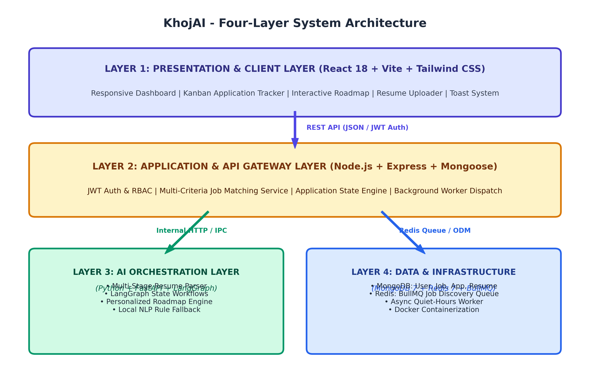
*Figure 4.1: KhojAI Four-Layer Distributed System Architecture*

- **Layer 1 (Presentation):** React 18, Vite, Tailwind CSS, Zustand, TanStack Query.
- **Layer 2 (API Gateway & Core Logic):** Node.js, Express, Mongoose, Joi, JWT, BcryptJS.
- **Layer 3 (AI Orchestration Microservice):** Python, FastAPI, LangGraph state workflows, local NLP fallbacks.
- **Layer 4 (Data & Infrastructure):** MongoDB 7 (persistent data), Redis 7 (caching & queue broker), BullMQ (async worker), Docker Compose.

---

### 4.2 Use Case Modeling

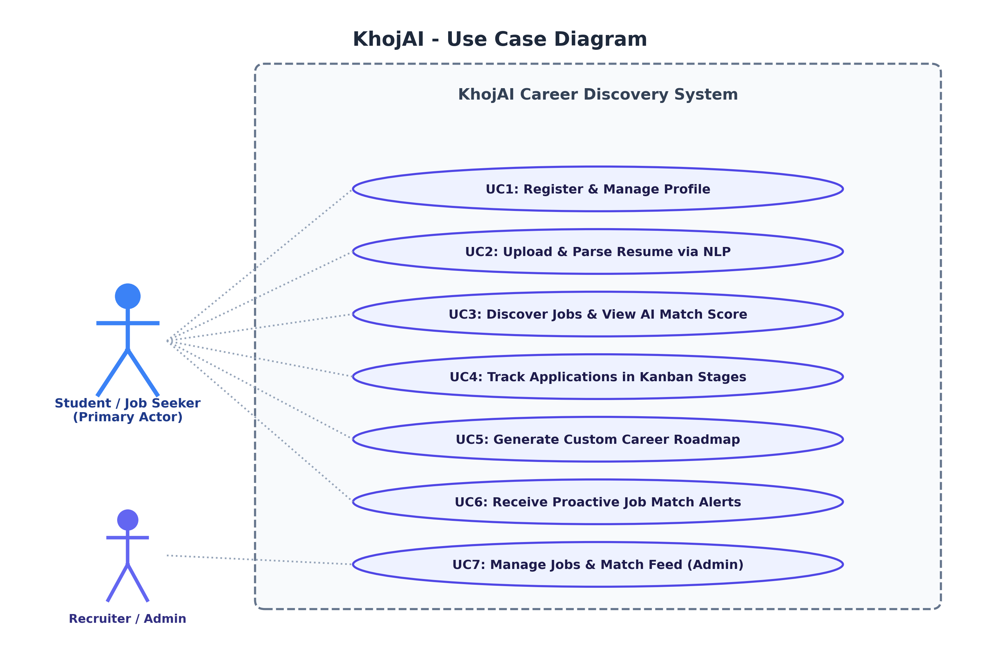
*Figure 4.2: Use Case Diagram for Job Seeker and Recruiter Interactions*

The primary actor (Job Seeker) interacts with six core use cases: Profile Setup, Resume Parsing, Job Discovery with Match Breakdown, Application Pipeline Tracking, Career Roadmap Synthesis, and Proactive Alert Ingestion. Recruiters and administrators manage verified job feeds and system match parameters.

---

### 4.3 Data Flow Modeling (Level 0, Level 1, Level 2 DFDs)

#### Level 0 Data Flow Diagram (Context Level)
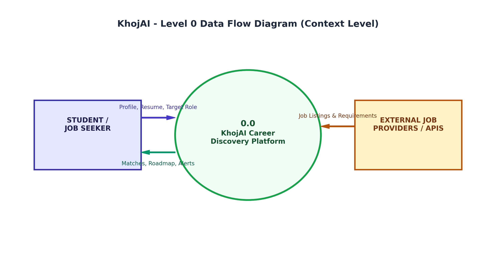
*Figure 4.3: Level 0 Data Flow Diagram (Context Level Boundary)*

#### Level 1 Data Flow Diagram (Core Functional Processes)
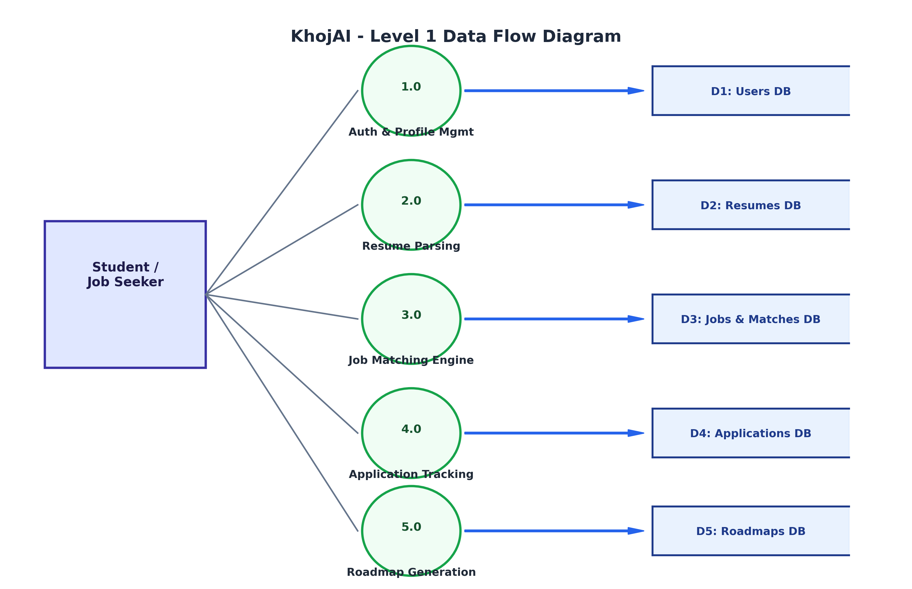
*Figure 4.4: Level 1 Data Flow Diagram (Core Functional Processes and Data Stores)*

#### Level 2 Data Flow Diagram (Process 3.0: Job Matching Engine Decomposition)
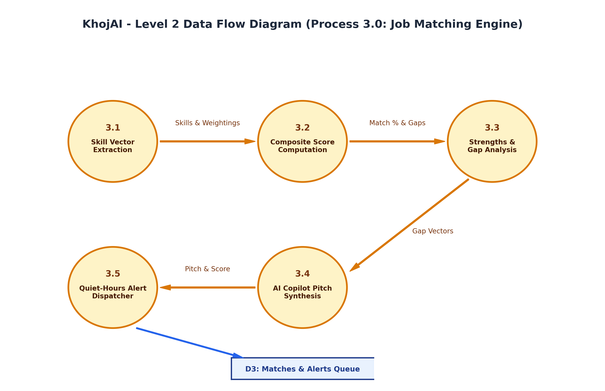
*Figure 4.5: Level 2 Data Flow Diagram (Decomposition of Process 3.0: Job Matching Engine)*

---

### 4.4 Module Information and Algorithmic Workflows

#### Table 4.1: Functional Modules
| Module Name | Primary Technologies | Core Responsibilities |
| :--- | :--- | :--- |
| **1. Auth & Profile Module** | Node.js, JWT, BcryptJS | User registration, credential hashing, token generation, profile & skill vector storage. |
| **2. Resume Parsing Engine** | Python, LangGraph, pdf-parse | PDF/DOCX extraction, regex/NLP entity recognition, structured skill tree extraction. |
| **3. Composite Job Matcher** | Node.js, Python, Mongoose | Four-dimensional weighted match computation, gap identification, copilot pitch generation. |
| **4. Background Discovery Worker** | BullMQ, Redis 7 | Asynchronous polling, periodic candidate-job evaluation, quiet-hours alert dispatching. |
| **5. Kanban Application Tracker** | React 18, Zustand, REST API | Application lifecycle tracking across 7 stages, interview note recording, timeline history. |
| **6. Career Roadmap Generator** | FastAPI, LangGraph | Target role skill gap extraction, sequenced learning milestones (courses, projects, system design). |

#### Algorithmic Formulation of Composite Job Matching
The composite match score $S$ is calculated as:
$$S = (0.50 \times S_{\text{skills}}) + (0.25 \times S_{\text{exp}}) + (0.15 \times S_{\text{loc}}) + (0.10 \times S_{\text{edu}})$$

#### Table 4.2: Matching Weight Distribution
| Dimension | Weight | Algorithmic Formulation |
| :--- | :---: | :--- |
| **Skills Overlap ($S_{\text{skills}}$)** | 50% | Jaccard coefficient: $\|Candidate\_Skills \cap Job\_Skills\| / \|Job\_Skills\|$ |
| **Experience ($S_{\text{exp}}$)** | 25% | Candidate years of tenure compared to role minimum requirement |
| **Location & Mode ($S_{\text{loc}}$)** | 15% | Direct match for Remote (1.0), geographic proximity for Hybrid/On-site (0.5-1.0) |
| **Education & Domain ($S_{\text{edu}}$)** | 10% | Degree level and specialization alignment |

---

### 4.5 Real-Life System Screenshots and In-Depth Technical Analysis

#### Figure 4.6: Landing Page & Value Proposition
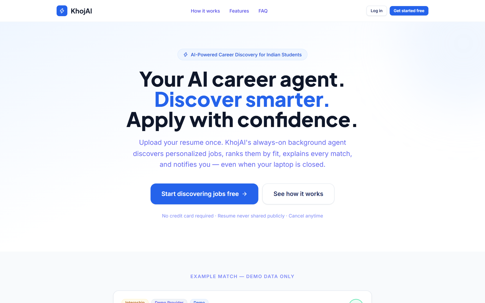
*Figure 4.6: Screenshot of KhojAI Landing Page & Value Proposition*
- **Feature of the Technology/Tool:** Implements React 18 functional components styled with a custom Tailwind CSS color palette, featuring glassmorphism cards, responsive hero banners, animated gradient text, and clear calls-to-action.
- **Application of the Module in Project:** Acts as the public portal and initial entrypoint for candidates, presenting platform capabilities (proactive discovery, AI resume parsing, match breakdown) and prompting authentication.
- **Integration with Other Modules:** Connects directly to the React Router navigation tree and checks Zustand client authentication state to conditionally render navigation controls ('Go to Dashboard' vs 'Sign In').
- **Inputs and Outputs:** User HTTP GET request to root domain (`/`). Output: Rendered responsive landing layout with navigation links to Login, Registration, and product feature demonstrations.

---

#### Figure 4.7: User Authentication & Secure JWT Sign-in
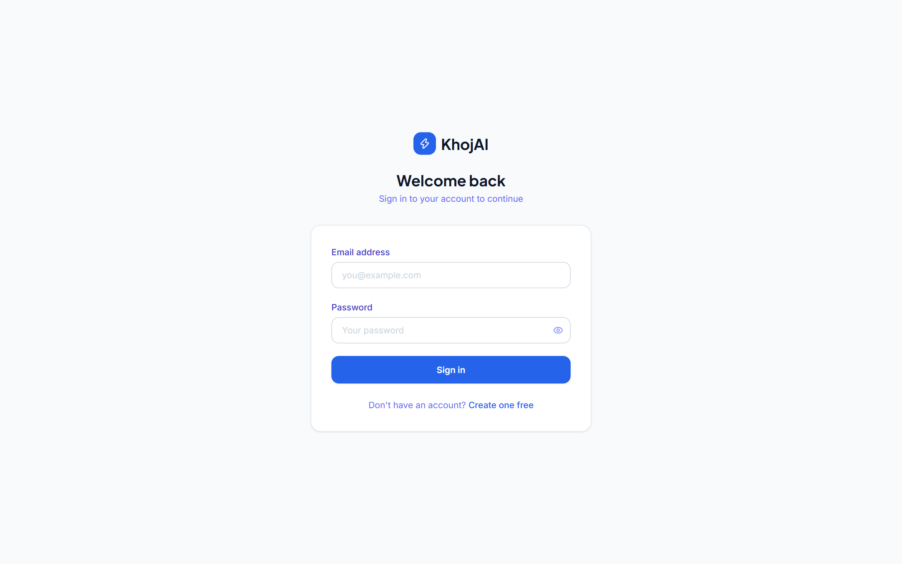
*Figure 4.7: Screenshot of User Authentication & JWT Sign-in Interface*
- **Feature of the Technology/Tool:** Secure client-side form controls utilizing React state hooks, real-time input validation, toggleable password visibility, and asynchronous HTTP dispatch via Axios.
- **Application of the Module in Project:** Authenticates registered candidates, securely verifying credentials against MongoDB user collections and generating stateless JSON Web Tokens (JWT).
- **Integration with Other Modules:** Interacts directly with the `/api/v1/auth/login` endpoint on the Express API server; on success, hydrates the Zustand `useAuthStore` and persists the token in local storage.
- **Inputs and Outputs:** User email (`himanshu@khojai.dev`) and password string. Output: Signed JWT token containing user ID payload, authenticated user session, and redirection to the main dashboard.

---

#### Figure 4.8: Interactive Candidate Dashboard with Analytics
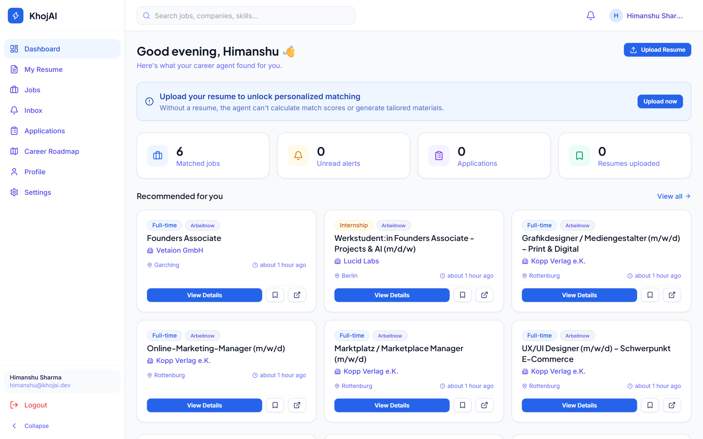
*Figure 4.8: Screenshot of Interactive Candidate Dashboard with Analytics*
- **Feature of the Technology/Tool:** Data visualization widgets powered by TanStack React Query and Lucide-React icons, presenting dynamic stat counters, recent job recommendations, and quick-action shortcuts.
- **Application of the Module in Project:** Serves as the central command console for the candidate, summarizing active applications, top job match scores, resume readiness score, and unread notification alerts.
- **Integration with Other Modules:** Aggregates data concurrently from multiple backend services: `jobsAPI.recommended()`, `resumeAPI.list()`, `applicationsAPI.list()`, and `notificationsAPI.unreadCount()`.
- **Inputs and Outputs:** Authenticated session token. Output: Unified dashboard view displaying total application counts, pending interviews, top AI matches, and instant navigation shortcuts.

---

#### Figure 4.9: AI Job Discovery Explorer with Match Scoring
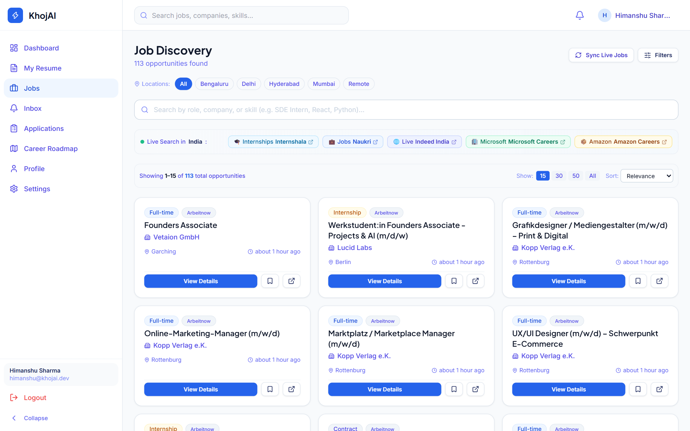
*Figure 4.9: Screenshot of AI Job Discovery Explorer with Match Scoring*
- **Feature of the Technology/Tool:** High-performance client-side filtering, multi-criteria search, pagination controls, and dynamically styled badge chips displaying computed match percentages.
- **Application of the Module in Project:** Enables candidates to search through over 113 indexed technical positions, filter by experience level (Junior, Mid, Senior), work mode (Remote, Hybrid, On-site), and sort by AI match percentage.
- **Integration with Other Modules:** Interfaces with the `/api/v1/jobs` REST endpoint; each job card displays real-time match scores computed by the Composite Matching Service based on the candidate's active profile.
- **Inputs and Outputs:** Filter parameters (keywords, work mode, minimum score threshold). Output: Paginated collection of relevant job postings with company names, locations, salaries, and match badges.

---

#### Figure 4.10: Job Detail View with AI Strengths, Gaps & Copilot Pitch
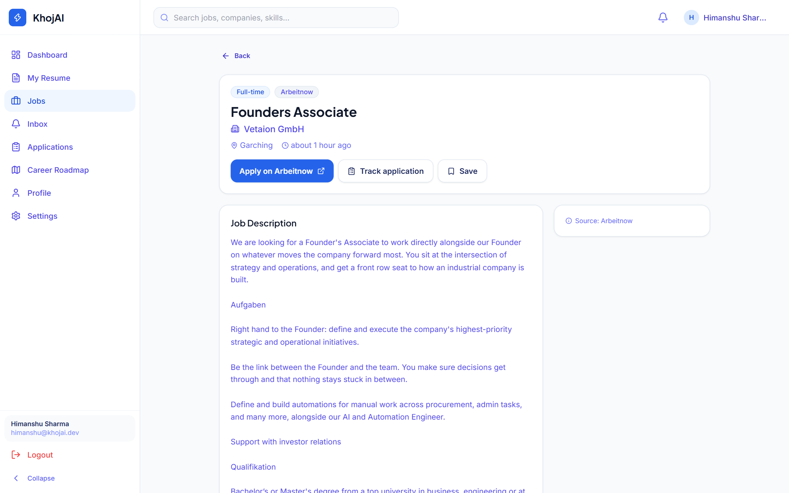
*Figure 4.10: Screenshot of Job Detail View with AI Strengths, Gaps & Copilot Pitch*
- **Feature of the Technology/Tool:** Modal slide-over and detailed card view rendering dynamic markdown, progress bars for match score breakdown, categorized strengths, missing skill tags, and an AI-synthesized pitch.
- **Application of the Module in Project:** Provides complete explainability for recruitment decisions. Shows exactly which candidate skills matched (e.g. React, Node.js), what skills are lacking (e.g. AWS, CI/CD), and produces a tailored elevator pitch.
- **Integration with Other Modules:** Integrates the Python LangGraph AI microservice with the Node.js backend. Outputs from the matching engine directly populate the UI pitch generator and provide one-click 'Apply' actions.
- **Inputs and Outputs:** Target Job ID and User Profile ID. Output: Granular match diagnostic (e.g. 85% match), identified skill gaps, customized application pitch, and application submission button.

---

#### Figure 4.11: Visual Kanban Application Pipeline Tracker
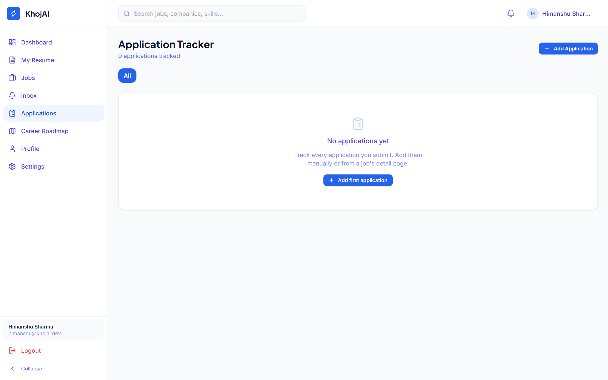
*Figure 4.11: Screenshot of Visual Kanban Application Pipeline Tracker*
- **Feature of the Technology/Tool:** Multi-column responsive Kanban board tracking applications across seven discrete status columns: Bookmarked, Applied, Screening, Interviewing, Offered, Rejected, and Withdrawn.
- **Application of the Module in Project:** Empowers job seekers to manage their entire career pipeline visually, eliminating spreadsheet tracking and enabling fast status updates.
- **Integration with Other Modules:** Integrates with the MongoDB `Application` model via `/api/v1/applications`. Updates trigger status change logs and sync with dashboard metric widgets.
- **Inputs and Outputs:** Application ID and target column state. Output: Real-time UI transition, persistent status update in MongoDB, and historical timeline logging.

---

#### Figure 4.12: Dynamic Personalized Career Roadmap & Milestone Plan
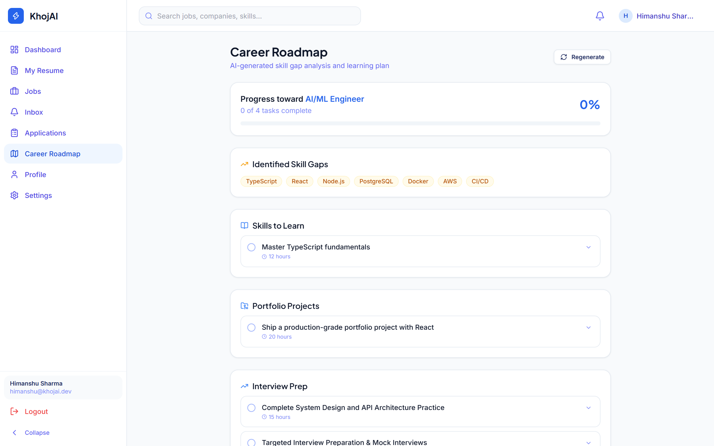
*Figure 4.12: Screenshot of Dynamic Personalized Career Roadmap & Milestone Plan*
- **Feature of the Technology/Tool:** Interactive timeline visualization categorizing milestones into Courses, Hands-on Projects, System Design architectures, and Mock Interviews with completion checkboxes.
- **Application of the Module in Project:** Translates candidate skill deficits into an actionable, step-by-step career upskilling journey targeting specific career roles (e.g., AI/ML Engineer, Full Stack Developer).
- **Integration with Other Modules:** Generated by the LangGraph AI service through the `/api/v1/roadmap/generate` route; updates to milestone completion state persist to MongoDB and update the candidate's skill matrix.
- **Inputs and Outputs:** Candidate current skills and target dream role. Output: Multi-stage roadmap with curated milestones, estimated completion hours, and progressive mastery tracking.

---

#### Figure 4.13: Resume Multi-Stage Parser & Structured Extractor
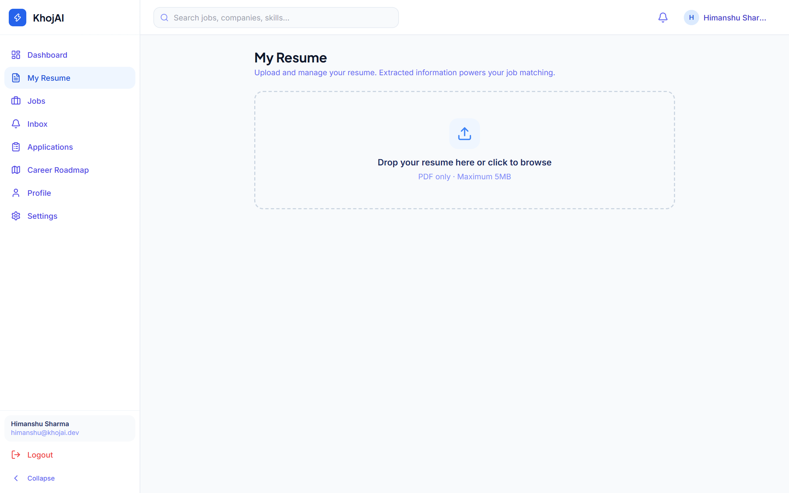
*Figure 4.13: Screenshot of Resume Multi-Stage Parser & Structured Extractor*
- **Feature of the Technology/Tool:** Drag-and-drop document uploader with client-side file validation (PDF/DOCX, 5MB limit), real-time upload progress bar, and structured entity preview tabs.
- **Application of the Module in Project:** Parses unstructured resume files into structured JSON schemas, extracting candidate contact information, categorized skill taxonomy, educational history, and work tenures.
- **Integration with Other Modules:** Connects to Multer file-handling middleware on the server, which forwards raw text to the LangGraph resume parsing workflow in the Python microservice.
- **Inputs and Outputs:** Binary resume document (`resume.pdf`). Output: Structured resume profile with normalized skill badges, parsed experience tenure, and ATS optimization recommendations.

---

#### Figure 4.14: Proactive Smart Notification Inbox with Quiet Hours
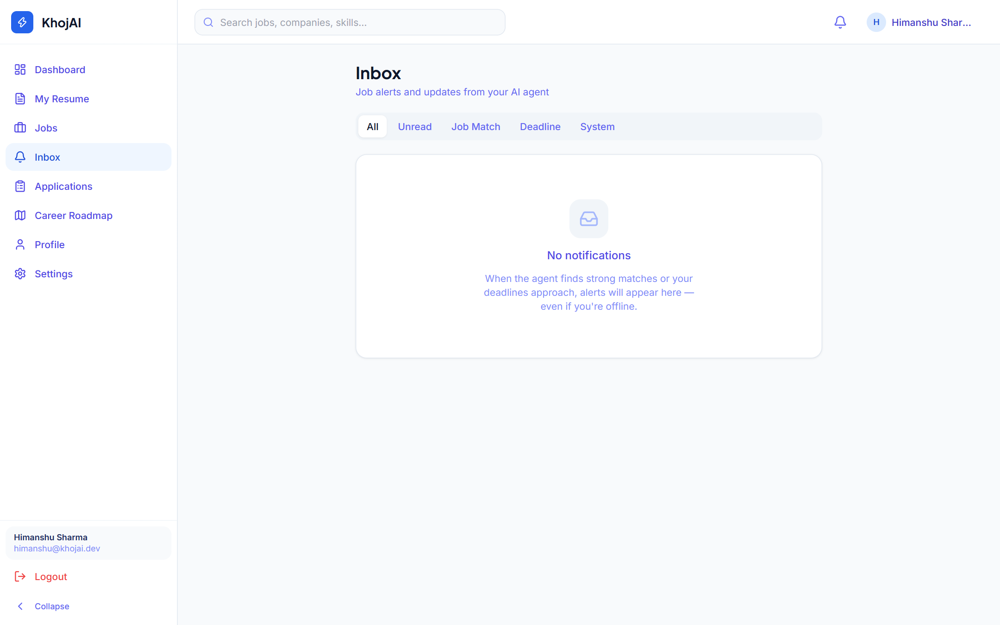
*Figure 4.14: Screenshot of Proactive Smart Notification Inbox with Quiet Hours*
- **Feature of the Technology/Tool:** Notification center with unread badge counters, instant mark-as-read toggles, category filtering, and time-formatted relative timestamps.
- **Application of the Module in Project:** Alerts candidates the moment a new job matching their threshold is discovered by the background BullMQ worker, while strictly adhering to configured Quiet Hours (e.g. 10 PM - 8 AM).
- **Integration with Other Modules:** Consumes events dispatched by the Redis BullMQ background worker and provides one-click navigation directly to the matched job detail view.
- **Inputs and Outputs:** Scheduled background matching events. Output: In-app notification cards with match percentage, job title, company name, and direct application links.

---

#### Figure 4.15: User Profile & Multi-Disciplinary Skills Matrix
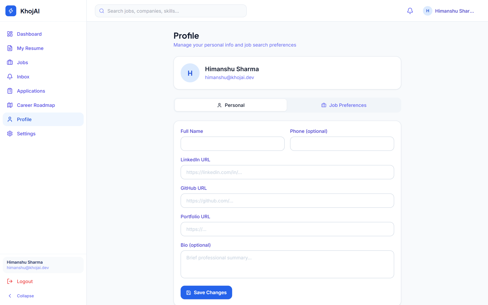
*Figure 4.15: Screenshot of User Profile & Multi-Disciplinary Skills Matrix*
- **Feature of the Technology/Tool:** Interactive skill tag input with keyboard chip creation, target role selector, years-of-experience slider, and preferred work mode selectors.
- **Application of the Module in Project:** Serves as the ground-truth candidate profile that parameterizes all downstream AI matching, roadmap generation, and proactive alert filters.
- **Integration with Other Modules:** Direct bidirectional sync with MongoDB `User` model; any update automatically triggers an asynchronous background recalculation of job match scores across all active postings.
- **Inputs and Outputs:** User inputs (skills list, target roles, preferred locations). Output: Persisted candidate profile vector and instant recalibration of job match scores.

---

## Chapter 5: Conclusions and Future Scope

### 5.1 Utilization in Final Year Major Project Scope
The foundational architecture, algorithmic models, and software engineering methodologies developed during this BCC-551 Mini Project establish a direct launchpad for the candidate's Final Year Major Project (CSE-851 / CSE-852). The microservices infrastructure will be expanded in the following key directions:
1. **Deep Vector Embedding & Semantic RAG Search:** The composite matching engine will be upgraded from heuristic weighting to neural dense vector embeddings using domain-adapted BERT/RoBERTa models and Pinecone/Milvus vector databases for cosine semantic similarity search.
2. **Autonomous AI Mock Interviewer Agent:** Implementing real-time audio and video synthesis agents powered by WebRTC and conversational LLMs to conduct automated technical mock interviews and provide multimodal candidate feedback.
3. **Enterprise ATS Connector & Large-Scale Crawlers:** Integrating distributed web crawlers and official recruitment APIs (Greenhouse, Lever, Workday) to index hundreds of thousands of live global openings automatically.

### 5.2 Industrial Relevance and Production Readiness
KhojAI addresses acute, high-value challenges within the global recruitment technology sector, estimated as a multi-billion dollar market. By eliminating manual keyword searching and replacing it with explainable, multi-dimensional matching, KhojAI drastically reduces time-to-hire for employers while dramatically lowering candidate application fatigue.

From a systems engineering perspective, KhojAI is architected for enterprise production readiness:
- **Containerized Infrastructure:** Complete containerization enables single-command provisioning across staging, testing, and production cloud clusters (AWS ECS / Kubernetes).
- **High Availability & Fail-Safe Architecture:** The API server maintains autonomous local NLP fallbacks, ensuring continuous uptime even if remote LLM APIs encounter outages or latency spikes.
- **Security & Compliance:** Enforces Bcrypt hashing, signed stateless JWT tokens, strict Joi input validation, Helmet security headers, and rate limiting to resist malicious attacks.

### 5.3 Societal Relevance and Impact
The societal impact of KhojAI is particularly significant for Tier-2 and Tier-3 collegiate institutions and underrepresented engineering candidates. Often lacking institutional access to elite campus placements, students from regional colleges struggle to identify how their academic coursework translates into industry-demanded skillsets.

KhojAI democratizes career guidance by acting as a free, 24/7 personalized career mentor. By diagnosing exact skill gaps and structuring personalized, milestone-driven learning roadmaps, KhojAI transforms passive job rejection into proactive empowerment, directly supporting national initiatives in technical skill development, digital employment equity, and lifelong learning.

### 5.4 Future Enhancements and Roadmap
- **Phase 1: Browser Extension for One-Click Auto-Discovery:** Deploying Chrome and Firefox extensions allowing candidates to save external job postings directly into their KhojAI Kanban pipeline with a single click.
- **Phase 2: Native Mobile Applications & Push Alerts:** Integrating mobile push notifications via Google Firebase Cloud Messaging (FCM) and Apple Push Notification Service (APNs) for real-time mobile match delivery.
- **Phase 3: B2B Recruiter Portal & Talent Matching:** Developing a dedicated enterprise portal enabling corporate hiring teams to post positions, view anonymous AI-scored candidate shortlists, and schedule interviews.

---

## References
1. Vaswani, A., Shazeer, N., Parmar, N., Uszkoreit, J., Jones, L., Gomez, A. N., Kaiser, L., & Polosukhin, I. (2017). *Attention is all you need.* Advances in Neural Information Processing Systems (NeurIPS 2017), 30, 5998–6008.
2. Chase, H. et al. (2024). *LangGraph: Building Language Agents as Graphs.* LangChain Open-Source AI Documentation, https://langchain-ai.github.io/langgraph/.
3. Tiangolo, S. (2023). *FastAPI: High Performance, Easy to Learn, Fast to Code, Ready for Production.* https://fastapi.tiangolo.com/.
4. Banks, A., & Porcello, E. (2020). *Learning React: Modern Patterns for Developing React Applications* (2nd ed.). O'Reilly Media.
5. Chodorow, K. (2019). *MongoDB: The Definitive Guide - Powerful and Scalable Data Storage* (3rd ed.). O'Reilly Media.
6. Sanfilippo, S. (2022). *Redis Explained: In-Memory Data Structure Store.* Redis Open Source Documentation, https://redis.io/docs/.
7. Fielding, R. T. (2000). *Architectural Styles and the Design of Network-based Software Architectures.* Doctoral dissertation, University of California, Irvine.
8. Resig, J., Bibeault, B., & Maras, J. (2016). *Secrets of the JavaScript Ninja* (2nd ed.). Manning Publications.
9. ISO/IEC/IEEE 12207:2017. *Systems and Software Engineering — Software Life Cycle Processes.* International Organization for Standardization.
10. Allamar, J., & Grootendorst, M. (2024). *Hands-On Large Language Models.* O'Reilly Media.

---

## Appendices

### Appendix A: Core REST API Signatures
| HTTP Method | Route Endpoint | Auth Required | Description & Payload |
| :--- | :--- | :---: | :--- |
| `POST` | `/api/v1/auth/register` | No | Registers a new candidate; accepts name, email, password. |
| `POST` | `/api/v1/auth/login` | No | Authenticates user; returns signed JWT Bearer token. |
| `GET` | `/api/v1/jobs` | Optional | Retrieves paginated job listings with match scores. |
| `POST` | `/api/v1/resumes/upload` | Bearer JWT | Uploads PDF/DOCX resume for LangGraph parsing. |
| `GET` | `/api/v1/applications` | Bearer JWT | Fetches candidate applications categorized by stage. |
| `POST` | `/api/v1/applications` | Bearer JWT | Creates or updates application stage in Kanban. |
| `POST` | `/api/v1/roadmap/generate` | Bearer JWT | Invokes AI service to synthesize custom milestones. |

### Appendix B: Environment Configuration Variables
- `PORT`: Port for Express API gateway (default: 5000).
- `MONGODB_URI`: Connection string for persistent MongoDB 7 cluster.
- `REDIS_URL`: Redis connection URL for BullMQ messaging.
- `JWT_SECRET`: Cryptographic secret for signing stateless authentication tokens.
- `AI_SERVICE_URL`: Internal microservice URL for Python FastAPI container (default: `http://localhost:8000`).
- `LLM_PROVIDER`: AI inference backend selector (options: `gemini`, `openai`, `mock`).
