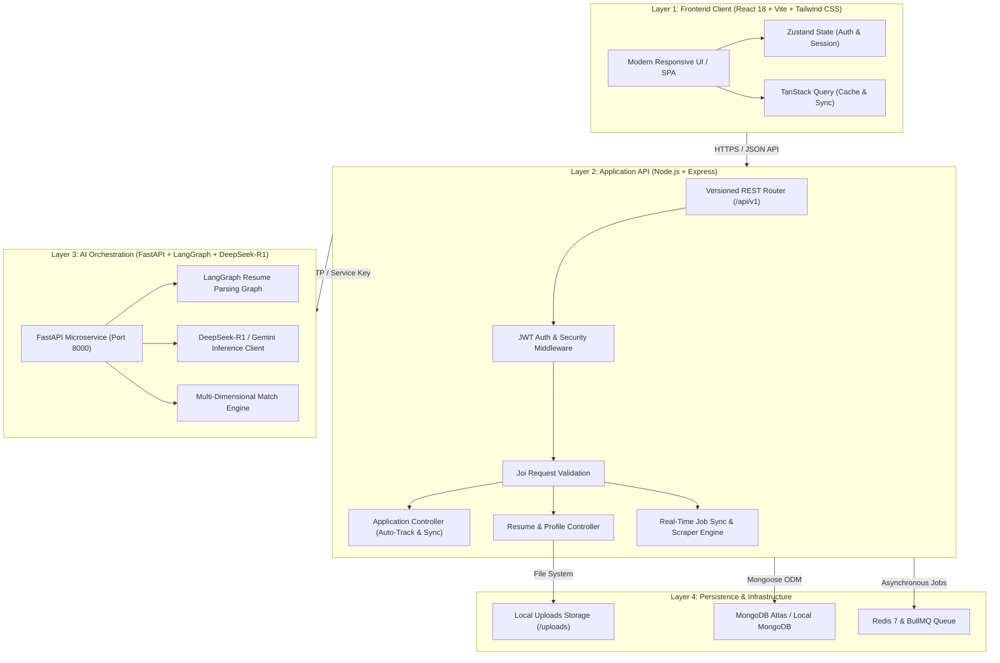
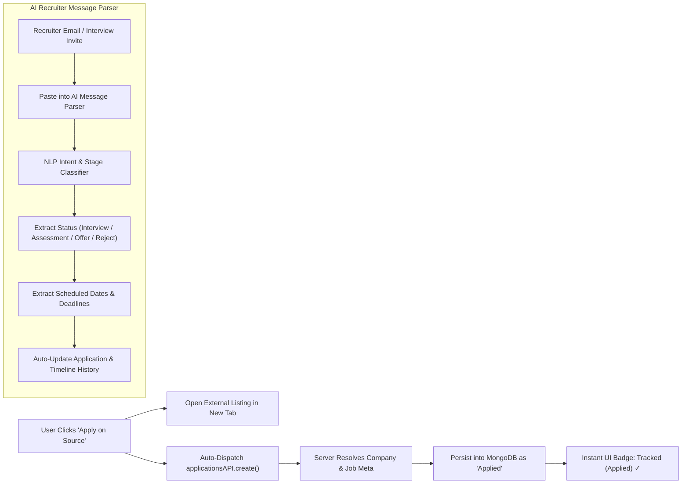
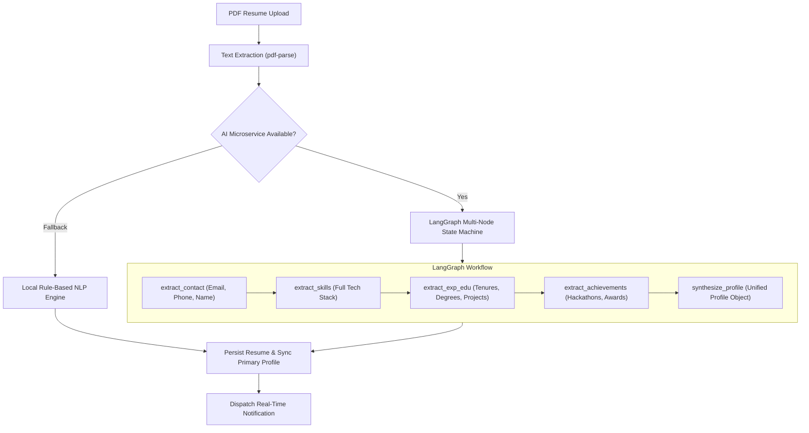
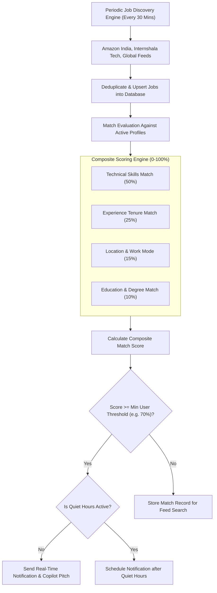
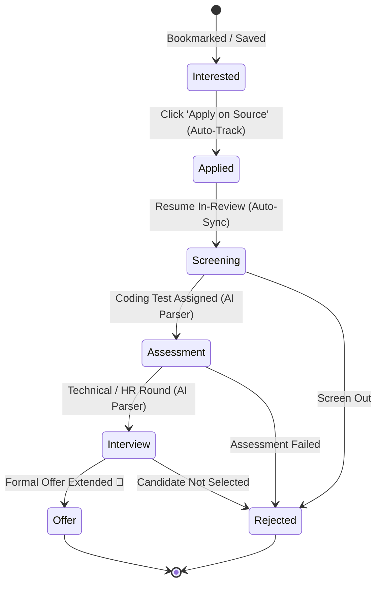

# KhojAI — AI Career Copilot & Job Discovery Platform

> **KhojAI** is an intelligent, full-stack AI career copilot and automated job discovery platform designed for students, freshers, and software engineers. It automates resume parsing, multi-dimensional job matching, background job scraping, zero-click application tracking, and AI-powered recruiter communication analysis.

---

## 🏛️ System Architecture

KhojAI is engineered as a resilient, multi-tiered microservices architecture:



---

## ⚡ Core Workflows & Mermaid Flow Diagrams

### 1. Zero-Click Job Application Auto-Tracking & AI Message Sync

Unlike traditional job boards requiring manual entry, KhojAI tracks applications automatically upon applying, and utilizes NLP to update pipeline stages from recruiter emails:



---

### 2. Intelligent Resume Ingestion & LangGraph Pipeline

Resumes undergo multi-pass parsing with LangGraph state graphs and local NLP fallbacks to guarantee 100% extraction reliability without missing skills or achievements:



---

### 3. Multi-Dimensional Job Matching & Proactive Alerts

Jobs discovered from Amazon, Internshala, and global feeds are scored against user profiles:



---

### 4. Application Lifecycle State Machine



---

## 🚀 Key Features

| Feature | Description |
| :--- | :--- |
| **Zero-Click Auto-Tracking** | Clicking *"Apply on [source]"* automatically registers the application in MongoDB under `Applied` with zero manual form filling. |
| **AI Message / Email Parser** | Paste recruiter emails, interview invites, or test links; the system identifies the company, stage, dates, and auto-progresses the status. |
| **Comprehensive Resume Parser** | Extracts all tech stack skills, hackathon achievements, certifications, projects, education, and career experience. |
| **DeepSeek-R1 / LangGraph Engine** | High-performance reasoning for deep profile synthesis and tailored AI Copilot application pitches. |
| **Live Job Discovery** | Background scraping synchronizes fresh opportunities from live tech boards every 30 minutes. |
| **Interactive Pipeline Tracker** | 1-click status advancement pills (`→ Screening`, `→ Assessment`, `→ Interview`, `🎉 Offer`) directly on cards. |
| **Built-in Account Recovery** | Quick password reset and 1-click credential switcher built into authentication. |

---

## 📂 Project Structure

```
KhojAI/
├── client/                     # Layer 1: React 18 + Vite + Tailwind CSS
│   ├── src/
│   │   ├── api/                # API client with JWT interceptors
│   │   ├── components/         # Reusable UI cards, badges, modals
│   │   ├── pages/              # Applications, Jobs, Resume, Dashboard, Auth
│   │   ├── store/              # Zustand Auth Store
│   │   └── main.jsx
│   └── package.json
│
├── server/                     # Layer 2: Node.js + Express API
│   ├── src/
│   │   ├── config/             # Database (MongoDB Atlas), DNS, JWT settings
│   │   ├── controllers/        # Application, Auth, Resume, Job controllers
│   │   ├── models/             # Application, User, Job, Resume, Match
│   │   ├── routes/             # REST endpoints (/api/v1/applications, /auth, etc.)
│   │   ├── services/           # RealJobFetcher, JobService, ResumeService
│   │   ├── validators/         # Joi validation schemas
│   │   └── server.js           # Server entrypoint
│   └── package.json
│
├── ai-service/                 # Layer 3: Python + FastAPI + LangGraph
│   ├── app/
│   │   ├── workflows/          # StateGraph pipelines (resume_parser, job_matcher)
│   │   ├── schemas/            # Pydantic data models
│   │   ├── routes/             # Resume, Match, Roadmap endpoints
│   │   └── main.py             # FastAPI entrypoint
│   └── requirements.txt
│
├── docker-compose.yml          # Container orchestration
└── README.md
```

---

## 🛠️ Quick Start & Local Setup

### Prerequisites
- **Node.js** >= 18 LTS
- **Python** >= 3.10
- **MongoDB** (Atlas connection or local MongoDB instance)

---

### Running Locally

#### 1. Start the AI Microservice (FastAPI + LangGraph)
```bash
cd ai-service
pip install -r requirements.txt
uvicorn app.main:app --port 8000 --reload
```

#### 2. Start the Backend API (Node.js + Express)
```bash
cd server
npm install
npm run dev
```

#### 3. Start the Frontend Client (React + Vite)
```bash
cd client
npm install
npm run dev
```

Visit **http://localhost:5173** to use the application.

---

### Default Development Credentials

For quick local testing and evaluation:
- **Email:** `himanshu@gmail.com` *(or `himanshu@khojai.dev`)*
- **Password:** `Password@123`

---

## 🧪 Verification & Testing

```bash
# Verify client build
npm --prefix client run build

# Verify server syntax & health
node server/src/server.js
curl http://localhost:5000/api/v1/health

# Run AI service tests
cd ai-service && pytest
```

---

## 📄 License

ISC © 2026 KhojAI Team. Built for engineers, students, and ambitious job seekers.
